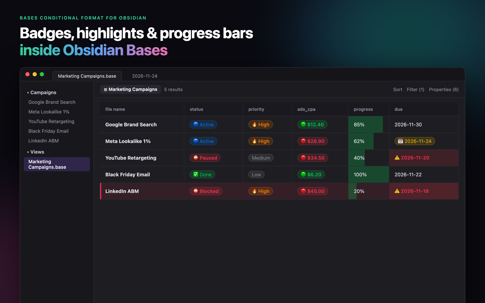
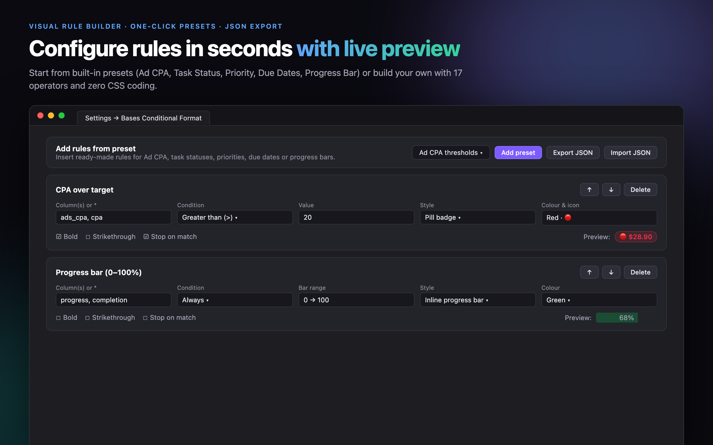

# Bases Conditional Format

> ⭐ If Bases Conditional Format makes your Bases easier to scan, a star helps other Obsidian users find it. Found a bug or have an idea? [Open an issue](https://github.com/chi-li-peppers/obsidian-bases-conditional-format/issues).

Add spreadsheet-style **conditional formatting**, **colour pill badges**, **row/card highlights** and **inline progress bars** to Obsidian **Bases** (and optionally Markdown / Dataview tables).

## Features

- **5 visual styles**: Pill badge, Cell fill, Text colour, Row / Card highlight, and pure-CSS **Inline progress bar**
- **Rich conditions**: `=`, `≠`, `contains`, `starts with`, `regex`, `>`, `≥`, `<`, `≤`, `between`, `is empty`, `date overdue`, `date is today`, `date within N days`, and `always`
- **Smart value parsing**: understands currency (`$25.50`, `€ 1.234,56`), percentages (`85%`), ratios (`3.2×`) and ISO dates (`YYYY-MM-DD`)
- **Non-destructive**: never edits your notes or breaks inline editing in Bases — uses pure CSS classes, CSS variables and `::before` icons
- **One-click presets**: Ad CPA thresholds, Task status badges, Priority highlights, Overdue due dates, and 0–100% Progress bars
- **Export / Import JSON**: share rule sets across vaults or teams
- **Theme-aware & mobile-friendly**: uses Obsidian's semantic colour variables so badges look great in both light and dark themes

## Visual rule builder

## Commands

| Command | What it does |
| --- | --- |
| Toggle conditional formatting | Quickly enable or disable all formatting rules |
| Refresh formatting in current view | Re-evaluate visible Bases and tables |
| Add rule from preset | Pick a ready-made rule pack from the command palette |

## Privacy

Bases Conditional Format makes **zero network requests**. All rules stay locally inside your vault.

## Install

Install manually by copying `main.js`, `manifest.json` and `styles.css` from the [latest release](../../releases/latest) to `<vault>/.obsidian/plugins/bases-conditional-format/` and enabling the plugin.

## License

[MIT](LICENSE) © 2026 David ([chi-li-peppers](https://github.com/chi-li-peppers))
